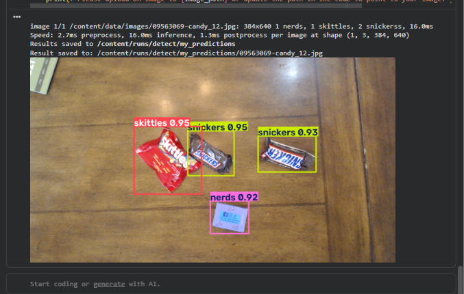

# YOLO Object Detection Using Google Colab

## Overview

This project explores training and testing a YOLO object detection model using Google Colab. It follows the training workflow demonstrated in the Edje Electronics tutorial.

The notebook covers dataset preparation, model training, prediction, and visualization of detection results.

## Objectives

- Understand the YOLO object detection workflow.
- Prepare image datasets for training and validation.
- Train an object detection model using a pretrained YOLO model.
- Evaluate model predictions on images.
- Visualize detected objects using bounding boxes and class labels.

## Technologies Used

- Python
- Google Colab
- Ultralytics YOLO
- PyTorch
- OpenCV
- IPython Display

## Project Workflow

1. Set up the Google Colab environment.
2. Download and prepare the dataset.
3. Split the images into training and validation sets.
4. Install the required libraries.
5. Configure the dataset.
6. Train the YOLO model.
7. Run object detection on images.
8. Visualize the prediction results.

## How to Run

1. Open `Train_YOLO_Models.ipynb` in this repository.
2. Open the notebook in Google Colab.
3. Select a GPU runtime if available.
4. Run the notebook cells in order.
5. Prepare the dataset as described in the notebook.
6. Train the model and run the prediction cells.
7. View the resulting images and training metrics.

## Model Output

The trained model saves its weights in the training results directory. The best-performing saved weights are typically named `best.pt`.

The prediction stage generates images containing detected objects, bounding boxes, and class labels.

## Sample Detection Output

## Dataset

The project follows the dataset preparation process described in the notebook. Refer to the notebook for the sample dataset download instructions and the required folder structure.

## Acknowledgements

This project follows the training workflow and educational material provided by Edje Electronics.

Original repository:
https://github.com/EdjeElectronics/Train-and-Deploy-YOLO-Models

## Disclaimer

This repository documents a learning project for understanding YOLO object detection and model training.
